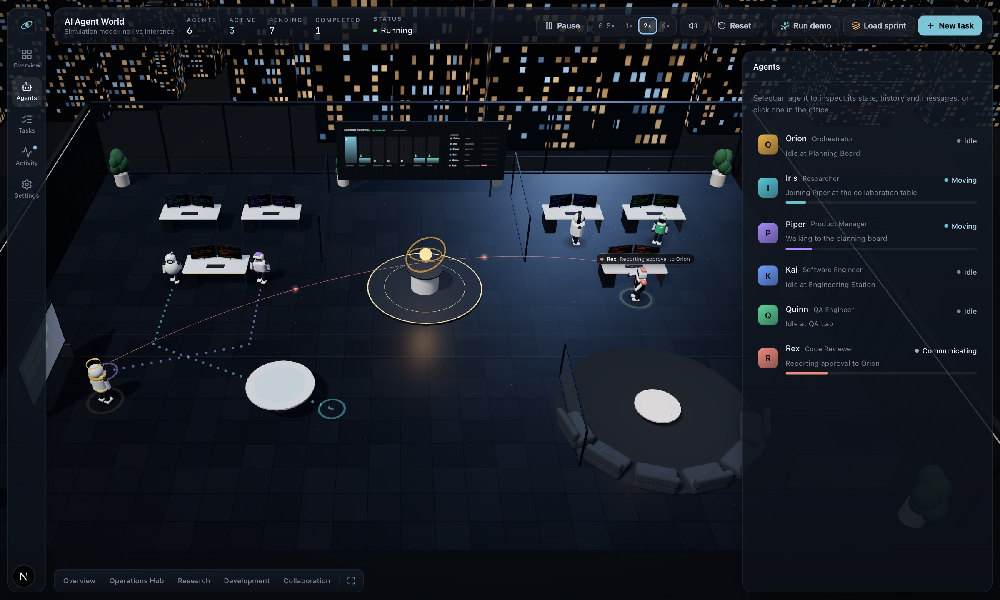
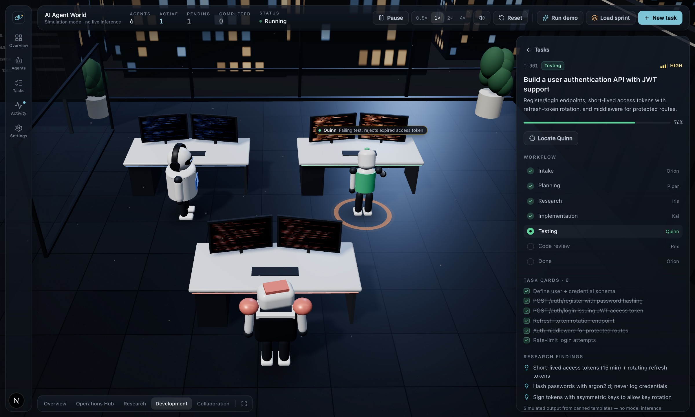
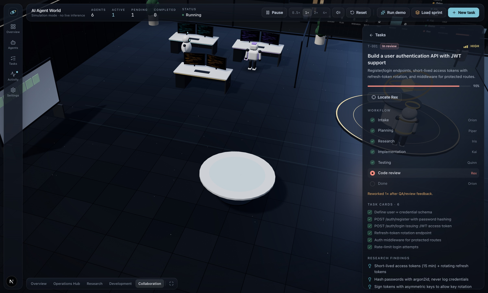
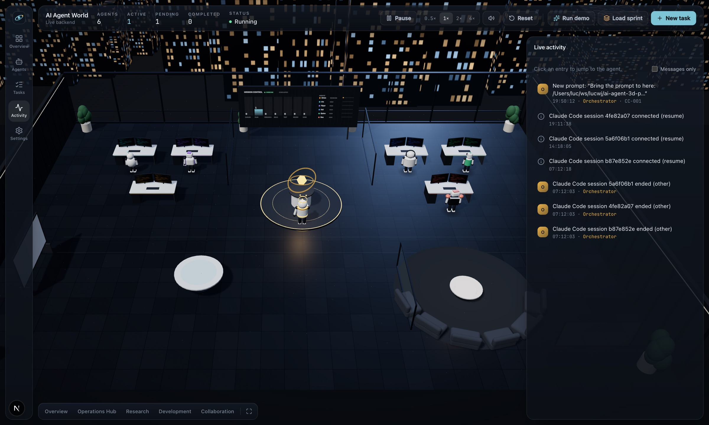

# AI Agent 3D Prompts

Prompt để tái tạo **AI Agent World**: một văn phòng 3D chạy trong trình duyệt, nơi sáu AI agent (Orchestrator, Product Manager, Researcher, Software Engineer, QA Engineer, Code Reviewer) phối hợp để "ship" một task phần mềm. Mọi bước đi, cử chỉ, màn hình sáng lên, bong bóng thoại, âm thanh và đường giao tiếp giữa các agent đều được điều khiển bởi trạng thái và một bộ từ vựng event cố định, không có animation trang trí nào nói dối về việc hệ thống đang làm.

*Prompts to rebuild AI Agent World, a 3D office where six AI agents visibly collaborate on software tasks. The prompt is in English; this README is in Vietnamese.*

> **Trạng thái:** repo này mới chỉ chứa prompt dựng **phần client** (giao diện 3D + mô phỏng). Chưa có backend nào đọc dữ liệu thật từ Claude, GPT, Gemini hay bất kỳ hệ thống agent nào. Xem mục [Phạm vi và giới hạn](#phạm-vi-và-giới-hạn).

## Ảnh demo

Ảnh chụp từ bản gốc được dựng bằng chính prompt này.



*Tổng quan giữa một sprint: Rex báo approval về Orion qua cung giao tiếp, Iris và Piper đi tới bàn collab theo đường chấm, khu Research bên trái, khu Development bên phải, mission-control wall phía sau. Thanh trên cùng ghi rõ "Simulation mode · no live inference".*



*Demo có kịch bản: Quinn đánh rớt build số 1 với test "rejects expired access token", bong bóng thoại hiện ngay trên đầu, panel bên phải cho thấy pha Testing cùng các task card đã xong.*



*Chi tiết task: workflow 7 pha, dòng "Reworked 1× after QA/review feedback", task cards và research findings. Nội dung là template, panel ghi rõ "Simulated output from canned templates".*



*Bản gốc có thêm một cầu nối thử nghiệm với Claude Code hooks: thanh trên cùng đổi thành "Live backend", feed hiện đúng prompt vừa gõ trong terminal. Phần này **không** nằm trong prompt ở repo này, xem mục giới hạn.*

## Điều kiện trước khi bắt đầu

**Bắt buộc:** cài bộ skill [cloudai-x/threejs-skills](https://github.com/cloudai-x/threejs-skills) cho coding agent **trước khi** dán prompt. Bộ skill này cho agent kiến thức đã kiểm chứng về three.js r186, React Three Fiber 9.8 và drei 10.7, đúng các phiên bản prompt yêu cầu. Không có nó, agent sẽ viết theo API cũ trộn từ nhiều bản three.js (ví dụ `PCFSoftShadowMap` đã bị bỏ ở r186, `Clock` đã nhường chỗ cho `Timer`) và bạn sẽ mất nhiều vòng sửa lỗi. Bản gốc được dựng với bộ skill này cài trong `.claude/skills/`.

Cài bằng CLI [skills](https://skills.sh):

```bash
npx skills add cloudai-x/threejs-skills
```

Hoặc cài thủ công. Claude Code đọc skill từ `~/.claude/skills/` (mọi project) hoặc `.claude/skills/` (một project):

```bash
git clone https://github.com/CloudAI-X/threejs-skills.git
mkdir -p .claude/skills && cp -r threejs-skills/skills/* .claude/skills/
```

Kiểm tra: thư mục `.claude/skills/` phải có các skill `threejs-fundamentals`, `threejs-react-three-fiber`, `threejs-lighting`, `threejs-geometry`, `threejs-materials`, `threejs-interaction`, `threejs-animation`, ... Với agent khác Claude Code, đưa nội dung các file `SKILL.md` vào context theo cách agent đó hỗ trợ.

Ngoài ra cần Node.js 22 trở lên và một trình duyệt có WebGL để xem kết quả sau mỗi giai đoạn.

## Cách dùng prompt

Prompt nằm ở [`prompts/ai-agent-world.md`](prompts/ai-agent-world.md).

1. Tạo một thư mục trống, cài threejs-skills vào đó (mục trên), rồi mở coding agent của bạn trong thư mục này (Claude Code, Cursor, Codex, v.v.).
2. Copy **toàn bộ** nội dung file prompt và dán vào agent. Prompt viết bằng tiếng Anh vì mã nguồn, tên biến và event đều bằng tiếng Anh; bạn vẫn có thể trò chuyện với agent bằng tiếng Việt.
3. Prompt được chia thành **8 giai đoạn**, mỗi giai đoạn có tiêu chí nghiệm thu (mục 11 trong prompt). Nên yêu cầu agent làm **từng giai đoạn một**: sau mỗi giai đoạn chạy `npm run typecheck`, `npm run lint`, `npm test`, và mở trình duyệt xem thật trước khi sang giai đoạn tiếp.
4. Nếu agent đủ mạnh và context đủ dài, có thể giao cả prompt một lần và yêu cầu nó tự đi theo thứ tự giai đoạn.
5. Mục **Known pitfalls** (mục 10) là những lỗi đã gặp thật khi dựng bản gốc. Đừng cắt mục đó khi chia sẻ hay rút gọn prompt.

Thứ tự giai đoạn trong prompt:

| Giai đoạn | Nội dung | Nghiệm thu |
| --- | --- | --- |
| 1 | Scaffold, domain model, state machine, scheduler, simulation engine (chưa có 3D) | `npm test` pass |
| 2 | Store, backend client, toàn bộ HTML UI | Chạy demo được với vùng 3D để trống |
| 3 | Canvas, ánh sáng, văn phòng, bàn làm việc, camera, tương tác | Văn phòng tĩnh nhìn hoàn chỉnh |
| 4 | Robot thủ tục theo vai, animator, đường đi, cung giao tiếp, bong bóng thoại | Xem được demo từ đầu đến cuối |
| 5 | Mission-control wall và planning board phản ánh task | Màn hình bàn sáng khi chủ bàn làm việc |
| 6 | Chất lượng và hiệu năng: fallback, reduced motion, mobile | 60 fps trên laptop, không lỗi console với StrictMode |
| 7 | Âm thanh tổng hợp bằng Web Audio | AudioContext chạy sau một click, cue phát trong demo |
| 8 | README, e2e, dọn dẹp | Lint, typecheck, test đều xanh |

Prompt mô tả stack cụ thể: Next.js 16, React 19, React Three Fiber 9, drei 10, three r186, Zustand 5, Tailwind 4, TypeScript 5.9. Bạn có thể đổi, nhưng mục Known pitfalls gắn với đúng các phiên bản này.

## Phạm vi và giới hạn

Nói thẳng để không ai kỳ vọng sai:

- **Chỉ là client.** Prompt dựng giao diện 3D, UI, và một **mô phỏng tất định** chạy ngay trong trình duyệt. Mọi task card, finding, tên test đều là template chọn theo từ khóa. Không có LLM nào được gọi, không có dòng code nào được viết ra thật.
- **Chưa có backend kết nối dữ liệu thật** của Claude, GPT, Gemini hay bất kỳ framework agent nào (LangGraph, CrewAI, ...). Prompt chỉ định nghĩa **contract** (giao thức WebSocket: `command` vào, `event` / `snapshot` / `ack` ra, cùng bộ từ vựng event) để sau này cắm backend thật vào mà không phải sửa lớp 3D và UI. Phần server implement contract đó chưa có trong repo này.
- Bản gốc có một cầu nối thử nghiệm đọc **Claude Code hooks** (ảnh 4), nhưng nó chạy local, chỉ hiểu Claude Code, và chưa được đưa vào prompt. Nó sẽ đi cùng mã nguồn khi open source.
- Prompt được viết và thử với Claude Code có cài threejs-skills. Kết quả phụ thuộc vào coding agent bạn dùng; bản gốc được dựng và sửa qua nhiều vòng, agent khác có thể cần thêm hướng dẫn ở từng giai đoạn.

## Những vấn đề cần cải thiện

Danh sách này là của bản gốc, tức là những gì prompt hiện tại tạo ra cũng sẽ mang theo.

**Kết nối hệ thống thật**

1. Chưa có backend thật. Đây là lỗ hổng lớn nhất: cần một server nói đúng contract WebSocket và nhận dữ liệu từ ít nhất một hệ thống agent thật (Claude Code hooks, Agent SDK stream, OpenAI Agents, LangGraph, ...).
2. Khi nối với agent thật, việc suy ra pha task và kết quả pass/fail còn dựa vào heuristic từ text. Cần quy ước đầu ra có cấu trúc (ví dụ dòng `VERDICT: PASS|FAIL`) hoặc event có schema từ phía orchestrator.
3. Workflow cố định một đường: queued → intake → planning → research → implementation → testing → review → done. Hệ thống thật có delegation lồng nhau, nhiều task song song với số agent không cố định, agent được tạo động. Mô hình 6 vai, 6 chỗ ngồi chưa thể hiện được điều đó.
4. Chưa có persistence và replay: reload là mất hết, không tua lại được một phiên làm việc để xem lại.

**Sản phẩm và trải nghiệm**

5. Nhân vật là robot thủ tục, animation còn ít (idle, đi, làm, nghĩ, nói, vui, lỗi). Chưa có đa dạng cử chỉ, chưa có tương tác giữa hai agent ở cùng một bàn.
6. Âm thanh là tổng hợp bằng oscillator, đủ để phân biệt sự kiện nhưng chưa "đẹp". Không có cách kiểm thử tự động chất lượng âm thanh.
7. Mobile mới ở mức chạy được (bottom sheet, low quality), chưa được thiết kế riêng. Màn hình nhỏ vẫn bị che bởi UI nổi.
8. Accessibility: thế giới 3D không có mô tả cho screen reader, bong bóng thoại không focus được, chỉ có panel HTML là dùng được bằng bàn phím.
9. UI chỉ có tiếng Anh, chưa có i18n.

**Kỹ thuật**

10. Test mới có headless cho engine và một e2e smoke bằng Playwright; chưa có visual regression cho lớp 3D, chưa có test cho âm thanh và camera.
11. Chế độ performance còn nặng trên máy không có GPU rời (đã thấy khi render bằng SwiftShader). Cần LOD cho skyline và robot, và một chế độ "tối giản" thật sự.
12. Prompt dài (~42 KB). Agent có context ngắn dễ bỏ sót chi tiết ở các mục sau; cần một phiên bản rút gọn theo từng giai đoạn để dán riêng.
13. Bản gốc chưa có git history sạch và chưa có CI; mục 8 của prompt mới dừng ở lint, typecheck, test chạy tay.

## Kế hoạch

Tôi sẽ **open source toàn bộ sản phẩm** sau khi hoàn thiện: mã nguồn client, world server, cầu nối Claude Code, và bộ prompt dùng để dựng nó. Repo này là bước đầu tiên: công khai prompt trước để ai muốn tự dựng, thử nghiệm, hay góp ý về kiến trúc có thể bắt đầu ngay.

Thứ tự dự kiến:

1. Prompt client (repo này).
2. Mã nguồn client và world server, kèm cầu nối Claude Code hooks.
3. Adapter cho các nguồn dữ liệu khác (Agent SDK stream, OpenAI, LangGraph, ...).

Góp ý và issue về prompt xin gửi tại repo này.
